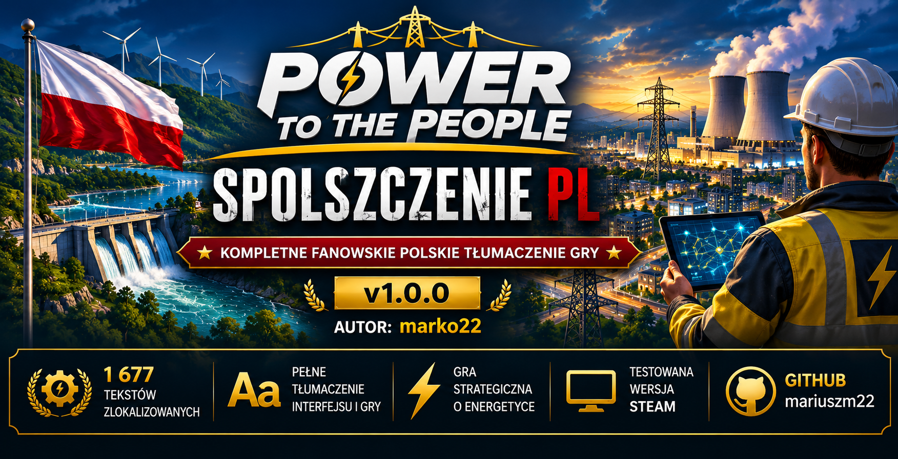
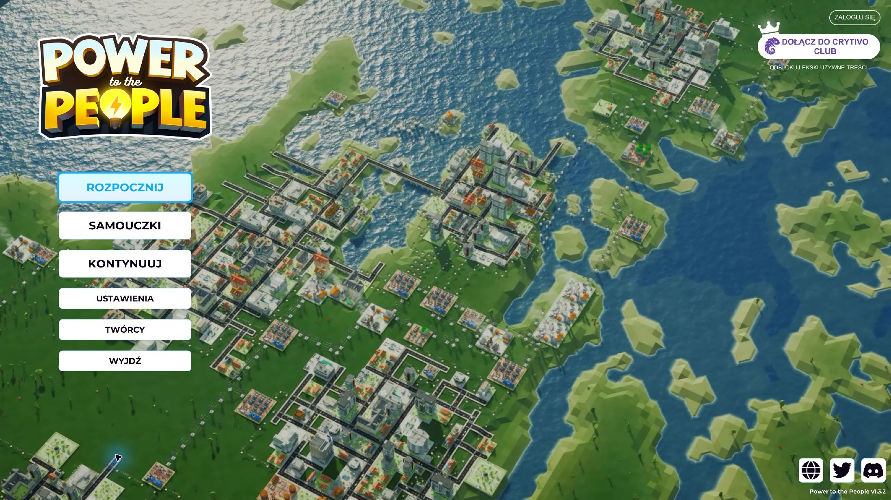
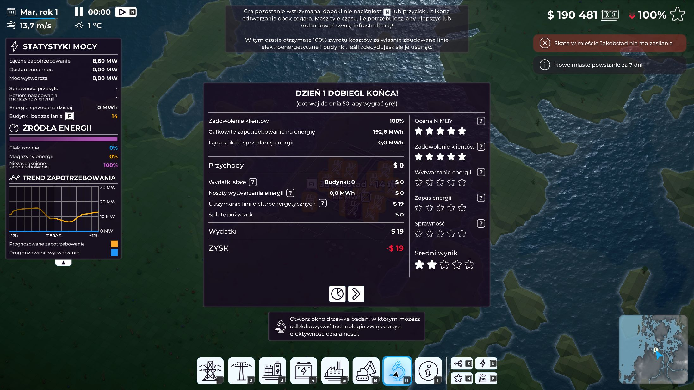
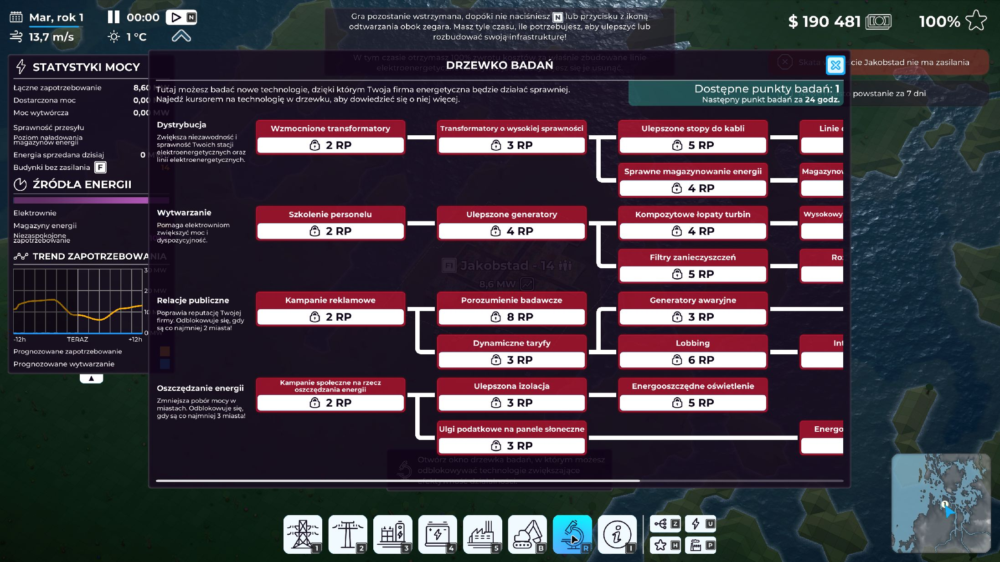
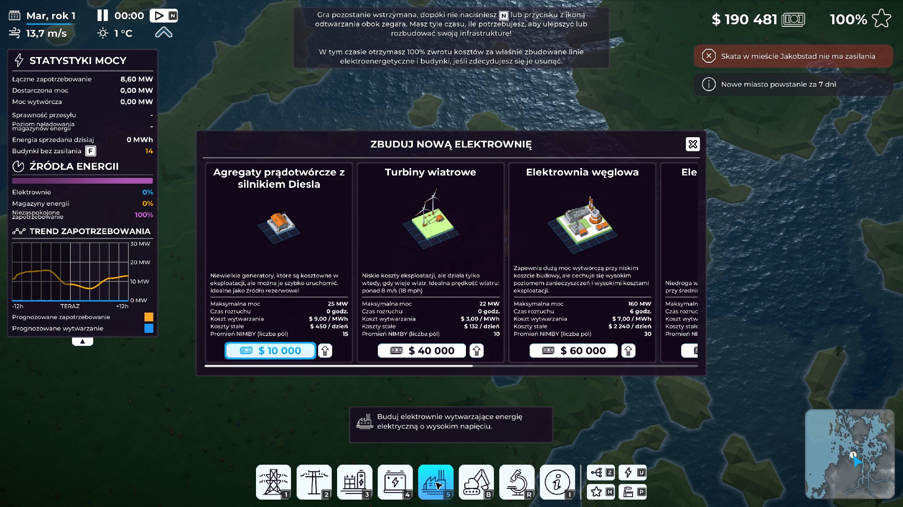
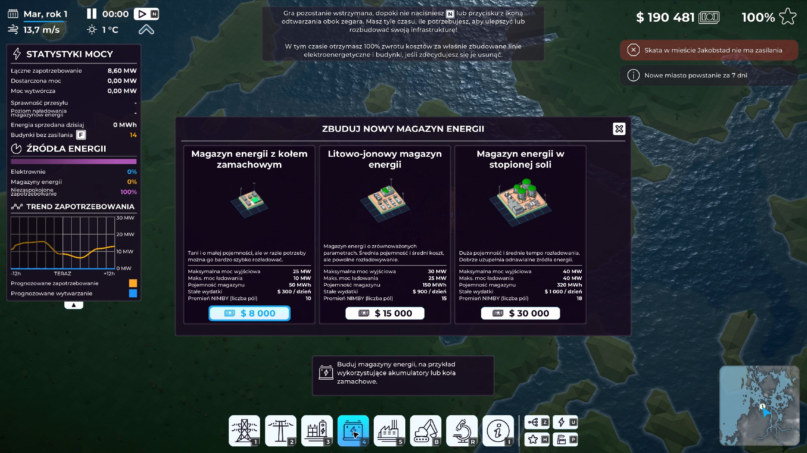
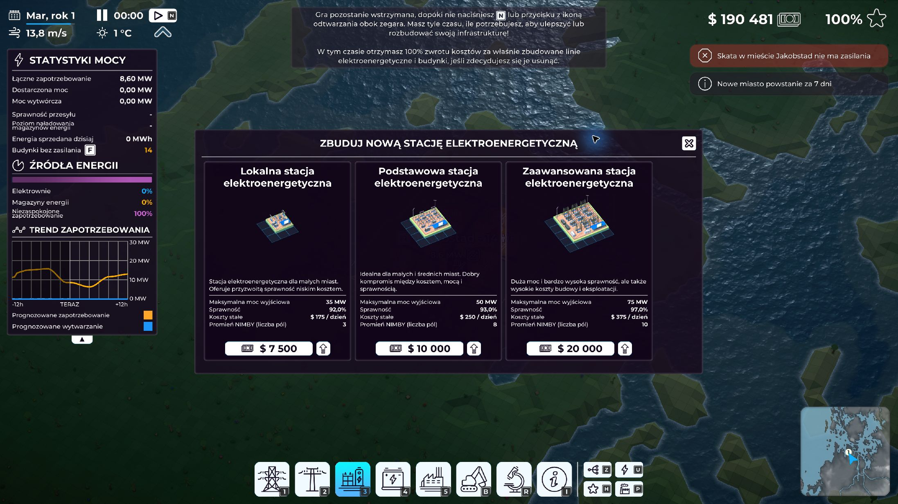

<p align="center"></p>

# Power to the People — Spolszczenie PL

Fanowska polska lokalizacja gry **Power to the People**, autorstwa **marko22**.

## 📦 Aktualne wydanie

**1.0.0** · Windows / Steam · gra **1.3.2**, build **20302782** · AppID **1413370**

➡️ **[Pobierz instalator z marko22.pl](https://marko22.pl/pobieranie#power-to-the-people)**  
➡️ [Opis, galeria i instrukcja](https://marko22.pl/power-to-the-people)

Instalator EXE jest dostępny na marko22.pl oraz w [wydaniu GitHub v1.0.0](https://github.com/mariuszm22/Power-to-the-People-Spolszczenie-PL/releases/tag/v1.0.0). Repozytorium przechowuje rzeczywiste źródła projektu.

## 📷 Polska wersja w grze

Dokładnie sześć zatwierdzonych zrzutów — ten sam zestaw co na stronie projektu. Kliknij zdjęcie, aby otworzyć pełny obraz.

<p align="center">
  <a href="screenshots/01-menu-pl.jpg"></a>
  <a href="screenshots/02-statystyki-pl.jpg"></a>
  <a href="screenshots/03-badania-pl.jpg"></a>
</p>

<p align="center">
  <a href="screenshots/04-elektrownie-pl.jpg"></a>
  <a href="screenshots/05-magazyny-pl.jpg"></a>
  <a href="screenshots/06-stacje-pl.jpg"></a>
</p>

## 📋 Zawartość tłumaczenia

- 1677 rekordów I2: interfejs, samouczki i dialogi, opisy miast, budynków, technologii i magazynów energii, wydarzenia oraz komunikaty.
- Trzy dodatkowe napisy Crytivo Club w menu głównym.
- Język Polski jako osobna pozycja; pozostałe języki są zachowane.
- Ujednolicona terminologia elektroenergetyczna, w tym rozróżnienie mocy MW i energii MWh.

## ⚙️ Instalacja i aktualizacja

1. Zamknij grę i [pobierz instalator](https://marko22.pl/pobieranie#power-to-the-people).
2. Uruchom kreator i sprawdź wykryty folder Steam albo wskaż katalog z `Power to the People.exe`.
3. Wybierz „Instaluj spolszczenie”. Instalator sprawdzi zgodność plików i zachowa oryginalną kopię bezpieczeństwa.
4. Rozpoznaną wcześniejszą wersję marko22 zaktualizujesz tym samym instalatorem. Zachowaj folder kopii zapasowej.
5. Po udanej instalacji ustawiany jest język **Polski (`pl`)**. Jeżeli zapis ustawienia się nie powiedzie, wybierz Polski w grze. **Auto może oznaczać angielski.**

Do usunięcia spolszczenia użyj tego samego instalatora i opcji „Usuń / przywróć”. Przywracane są oryginalne pliki oraz poprzedni wybór języka.

[Pełna instrukcja instalacji i aktualizacji](docs/INSTALACJA_I_AKTUALIZACJA.txt)

Instalator nie ma komercyjnego podpisu cyfrowego. Suma kontrolna oficjalnego pliku jest dostępna w [manifeście wydania](release/1.0.0/manifest.json) i [pliku SHA-256](release/1.0.0/installer.sha256).

## 🛠️ Źródła i odtworzenie projektu

| Katalog | Zawartość |
|---|---|
| `translation/` | Pełne EN↔PL 1.0.0, słownik i zatwierdzone decyzje |
| `installer/` | Oryginalne źródła C#, grafiki, konfiguracja i łatki 1.0.0 |
| `tools/` | Lokalne narzędzia I2, formatu łatek i zmian menu |
| `docs/` | Instrukcje, architektura, zakres QA i „Kulisy spolszczenia” |
| `screenshots/` | Sześć rzeczywistych zrzutów z polskiej gry |
| `release/1.0.0/` | Publiczny manifest oraz sumy kontrolne |

Instalator można przebudować z dołączonych źródeł i łatek, bez instalowania gry i bez API:

```powershell
powershell -NoProfile -ExecutionPolicy Bypass -File .uild.ps1 -WizardOnly
```

Wynik trafia do ignorowanego katalogu `build/`. [Instrukcja odtworzenia i dalszego rozwoju](docs/BUILD.md) opisuje wymagania oraz pracę z własnymi plikami gry.

## 🎬 Kulisy spolszczenia

[Przeczytaj autorską historię powstawania polskiej wersji](https://marko22.pl/assets/downloads/power-to-the-people/Kulisy_spolszczenia_Power_to_the_People.html). W repozytorium znajduje się również [ten sam dokument HTML do pobrania i otwarcia offline](docs/Kulisy_spolszczenia_Power_to_the_People.html).

## ✅ Sprawdzenie jakości

Kontrole danych objęły wszystkie 1677 rekordów. Sprawdzono mechanizm instalacji, aktualizacji, backupu, przywracania oraz wyboru języka. W działającej grze potwierdzono polskie menu i wybrane ekrany rozgrywki. Nie oznacza to przejścia wszystkich scenariuszy; [zakres QA i znane ograniczenia](docs/QA.md) opisano osobno.

## 📜 Historia zmian

[CHANGELOG.md](CHANGELOG.md) · [Szczegóły ostatnich korekt 1.0.0](docs/ZMIANY_1.0.0.txt)

## 🤝 Autor i kontakt

Tłumaczenie i redakcja: **marko22**.  
[marko22.pl](https://marko22.pl) · [Wsparcie projektu](https://paypal.me/mariuszm22) · [Zgłoś błąd](https://github.com/mariuszm22/Power-to-the-People-Spolszczenie-PL/issues)

Przy zgłoszeniu podaj wersję gry i spolszczenia, miejsce wystąpienia problemu oraz zrzut ekranu.

To nieoficjalna lokalizacja. Power to the People i materiały gry należą do ich właścicieli. Wymagana jest legalna kopia gry. Zobacz [informacje o prawach i materiałach](RIGHTS.md).
